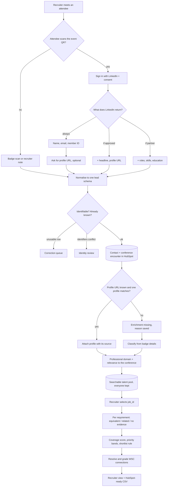

# Design document

## 1. The problem

Two things go wrong today, at two different moments.

**After a conference**, contacts are not captured anywhere. They sit on business cards and in phone notes and are forgotten within days.

**When a role opens**, even a saved list would not help much, because conference crowds are mixed. A DevOps event has platform engineers and SREs, and also IT managers, network admins and vendor sales reps. Someone would still have to screen every name by hand. This is the core pain: **signal-to-noise**.

So the system has to do two jobs: keep every encounter, and understand what each person actually does well enough that a recruiter never screens the full list.

## 2. Flow

The same flow as a larger, readable diagram: `docs/flow.html`.

In this exercise the CSV files stand for the *end state* of the first two stages: `conference_attendees.csv` is what capture produces, `linkedin_profiles.csv` is what an approved profile source returns. The code implements everything from "Normalise to one lead schema" onward.

## 3. Schema

| Entity | Key | Holds | Why it is separate |
|---|---|---|---|
| Contact | `hubspot_id`, email, LinkedIn URL | Name and identifiers | One person, however many times we meet them |
| Encounter | contact + conference + date | Conference, domain, date, source, recruiter note, title at the time | The context of each meeting survives job changes |
| Profile | LinkedIn URL | Title, company, skills, industry, past titles, connection IDs, source | What enrichment added, kept apart from what was captured |
| Classification | contact | Professional domains with evidence; relevance per encounter | Answers "what does this person do?" once, reused by every search |
| Match | contact + job | Evidence per requirement, score, band, shortlist flag | One row per person *and* role, so a second role never overwrites the first |
| Connection | contact + employee | Strength and the fact behind it | Shown beside the match, never inside the score |

## 4. Why this approach

- **Keep everyone, classify by profession.** Noise is relative to what the recruiter is looking for. A sales rep is noise in a DevOps search and the answer to a sales opening. Relevance is therefore a filter over a complete pool, not a gate at the door.
- **Evidence per requirement, then a score.** The unit of work is one requirement checked against one person, with the matched term and where it was found. The score is only the sum. This is what makes the logic explainable line by line.
- **A term table instead of string matching or a model's opinion.** Exact matching fails on this data: "Object Detection" is required for JOB001 and appears in zero profiles. Loose matching fails the other way: "Event Detection" is a different skill. An explicit table of equivalent, related and misleading terms handles both, is readable by a recruiter, and is changed without code.
- **Rules, not a model, for scoring.** A fixed rule treats every candidate the same way and can be audited. Research on selection decisions consistently finds that mechanical combination of information matches or beats holistic judgement, and that the exact weights matter far less than applying them consistently. Our own check agrees: six alternative weightings keep at least 7, and usually 9 or 10, of the top 10 for every job.
- **Bands instead of ranks.** 83.0 and 82.3 are not a meaningful difference. Showing them as first and third would be false precision.
- **Connections graded, not counted.** A LinkedIn connection is a click. Shared employer in overlapping years is evidence of acquaintance. Only about 13 of the 79 connection pairs in the data have it.
- **One engine, two entry points.** The command line and the browser view call the same functions, so a recruiter and an engineer never see two different answers.

## 5. Production version

| Layer | In this exercise | In production |
|---|---|---|
| Capture | `conference_attendees.csv` | A QR code per event opens a short page with *Sign in with LinkedIn* and explicit consent. The open sign-in returns name, email and a member ID only; a profile URL needs an additional permission LinkedIn must approve, and work history and skills come only through LinkedIn's talent partner integrations. The flow therefore works at all three levels and asks the attendee for a profile URL when it is not returned. Badge-scan exports and recruiter notes remain as the path for people who do not scan. |
| Enrichment | `linkedin_profiles.csv` | An approved source only: LinkedIn Recruiter with a CRM/ATS integration if WSC's licence and vendor support it, otherwise data the attendee shares. Profile data is stored only for members who authorised it. This is a licensing question to settle with WSC before building, not an engineering detail. |
| Talent pool | In memory | HubSpot. Contacts upserted in batches through the CRM API, keyed on a custom unique property (HubSpot does not support partial upserts keyed on email). Encounters and matches as custom objects associated with the contact, which is a separate API call from the upsert. |
| Role trigger | `--job JOB001` | Comeet's position webhook (created / updated) starts a matching run and notifies the recruiter. Comeet's candidate API supplies `ats_status` so people already in process are flagged before outreach. |
| Term table | Hand-written JSON | A language model *proposes* rows when a new role or an unfamiliar skill appears; a recruiter or hiring manager approves them. The model never scores a person. |
| Privacy | Simulated data | Purpose limited to recruiting, consent recorded at capture, retention period with deletion, one place to honour access and deletion requests. To be confirmed with legal counsel. |

## 6. At scale (hundreds of conferences, thousands of contacts)

- **Two processes with different triggers.** Building the pool happens per import; matching happens per role. A new role is a query over the existing pool, not a recomputation of it.
- **Incremental work only.** Enrich new contacts and profiles older than the refresh window. Re-match a role only when its requirements change, and a contact only when their profile changes.
- **Matching is cheap.** Each contact-job pair is a handful of set lookups. Ten thousand contacts against one role is well under a second; no vector database or model call is needed for the scoring itself.
- **The term table is the part that does not scale by hand.** Four roles can be mapped manually; a hundred cannot. This is where the model-assisted proposals in section 5 and a standard skills taxonomy (such as ESCO) earn their place.
- **Operational needs that appear with volume:** a queue with retries for enrichment, rate-limit handling for HubSpot, versioned term tables and weights so a past shortlist can be reproduced, and an audit log of who exported what.

## 7. With more time

1. **Measure it.** Have a recruiter and a hiring manager label a sample per role, including people below the line, and report how many of the top ten they would contact and who was missed. Without this, no weighting can be called accurate.
2. **Recruiter feedback loop.** "Not relevant" and "good find" buttons whose results feed the term-table review.
3. **Model-assisted evidence from free text.** Recruiter notes and past titles contain evidence the term table cannot see. A model would extract it with the exact quote, and the quote would be verified against the source before it counts.
4. **Seniority from responsibility, not titles and years.** The current rule is deliberately crude and worth only 5 points.
5. **Real integrations** behind the same interfaces: HubSpot upsert, Comeet webhook and ATS lookup.
6. **Outreach drafts** that mention where we met and the employee who can introduce us.

## References

- LinkedIn: [Sign In with LinkedIn using OpenID Connect](https://learn.microsoft.com/en-us/linkedin/consumer/integrations/self-serve/sign-in-with-linkedin-v2), [Getting access to LinkedIn APIs](https://learn.microsoft.com/en-us/linkedin/shared/authentication/getting-access), [Profile API](https://learn.microsoft.com/en-us/linkedin/shared/integrations/people/profile-api), [CRM Connect](https://business.linkedin.com/talent-solutions/linkedin-hiring-integrations/talent-crm-integration)
- HubSpot: [Contacts API](https://developers.hubspot.com/docs/api-reference/crm-contacts-v3/guide), [Using object APIs](https://developers.hubspot.com/docs/guides/crm/using-object-apis)
- Comeet: [Position Updates Webhook](https://developers.comeet.com/reference/position-updates)
- Scoring: Kuncel et al. (2013), *Mechanical versus clinical data combination in selection and admissions decisions*; Bobko, Roth & Buster (2007), *The usefulness of unit weights in creating composite scores*; Dawes (1979), *The robust beauty of improper linear models*.
