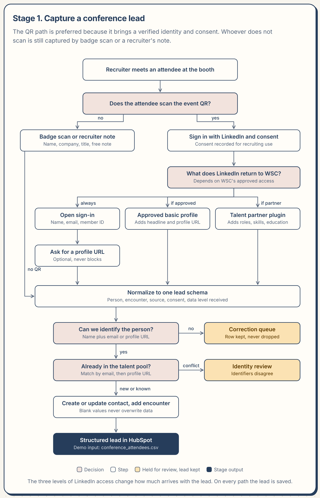
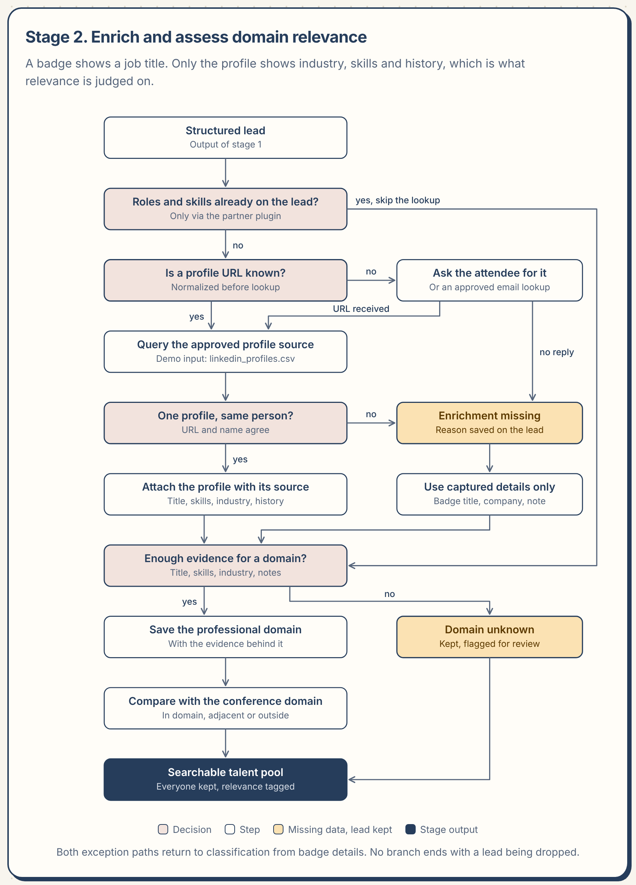
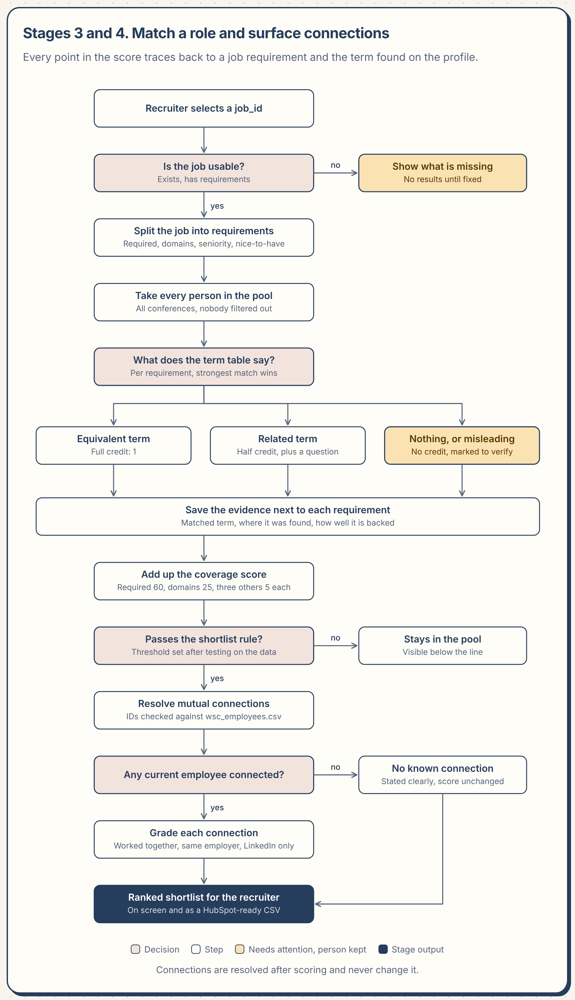

# Flow, schema and output

What the pipeline does at each step, what it stores, what it returns, and what happens when data is missing.
Contents: [flow](#1-flow), [step by step](#2-step-by-step), [data model](#3-data-model), [the output](#4-the-output), [missing and partial data](#5-missing-and-partial-data). The diagrams are also [one page](https://liad142.github.io/wsc-assignment/docs/flow.html) (`flow.html`).

## 1. Flow

Three diagrams, one per stage. Every branch ends with the person kept; none ends with a lead being dropped.

The CSV files stand for the *end state* of the first two stages: `conference_attendees.csv` is what capture produces and `linkedin_profiles.csv` is what an approved profile source returns. The code implements everything from "Normalize to one lead schema" onward.

## 2. Step by step

| Step | Goes in | What happens | Comes out | Why the step exists | Code |
|---|---|---|---|---|---|
| 1. Capture | `conference_attendees.csv` (in production: QR sign-in, badge-scan export, recruiter note) | Each row is validated. An existing contact is found by email, then by LinkedIn URL. A new conference adds an encounter; it never creates a second person. Unusable rows go to a correction queue, conflicting identifiers to identity review. | Contacts, each with a history of encounters | Today nothing is captured. Without one record per person, the same attendee met twice becomes two leads and their history is lost. | `src/ingest.js` |
| 2a. Enrich | Contacts, `linkedin_profiles.csv` (in production: an approved LinkedIn source) | The profile is attached by normalised URL. If that is not possible, the reason is saved and the contact stays. | Contacts with a profile or a stated reason | A badge shows a title and a company. What a person actually does is in the profile. | `src/enrich.js` |
| 2b. Classify | Enriched contacts, conference domain | Title, skills and industry decide the professional domain. That is compared with the conference domain: in domain, adjacent, outside or unknown. Nobody is removed. | A searchable talent pool | This is the signal-to-noise step: it separates the SRE from the IT manager at the same DevOps event, without a recruiter reading either profile. | `src/classify.js` |
| 3. Match | Pool, `job_openings.csv`, `job_id` (in production: Comeet position webhook) | Every requirement of the job is looked up in the term table: equivalent term = full credit, related = half, misleading = none, nothing found = "to verify". Credits add up to a score; near-ties form a band; a simple rule draws the shortlist line. | Ranked matches with the evidence behind each requirement | A new role should take minutes, not a re-screening of every past attendee. Evidence per requirement keeps the score explainable. | `src/match.js` |
| 4. Connections | Matches, `wsc_employees.csv` | Connection IDs are resolved to current employees and graded by shared work history: worked together, same employer, LinkedIn only. | A suggested next step per contact | A warm introduction is the best first contact, but only if the two people really know each other. | `src/connections.js` |
| Output | Matches | One flat row per contact and job. | CSV and the recruiter view | The recruiter acts on it without further processing; HubSpot can import it. | `src/exporter.js` |

## 3. Data model

| Entity | Key | Holds | Why it is separate |
|---|---|---|---|
| Contact | `hubspot_id`, email, LinkedIn URL | Name and identifiers | One person, however many times we meet them |
| Encounter | contact + conference + date | Conference, domain, date, source, recruiter note, title at the time | The context of each meeting survives job changes |
| Profile | LinkedIn URL | Title, company, skills, industry, past titles, connection IDs, source | What enrichment added, kept apart from what was captured |
| Classification | contact | Professional domains with evidence; relevance per encounter | Answers "what does this person do?" once, reused by every search |
| Match | contact + job | Evidence per requirement, score, band, shortlist flag | One row per person *and* role, so a second role never overwrites the first |
| Connection | contact + employee | Strength and the fact behind it | Shown beside the match, never inside the score |

## 4. The output

`node run.js --job JOB001` writes `output/JOB001_shortlist.csv`: one row per shortlisted contact, best first. `--all` writes every contact, including those below the line. The recruiter view (`app.html`) shows the same rows.

| Column | What it holds | HubSpot field |
|---|---|---|
| `hubspot_id` | The contact's ID from the attendee file | Record ID (identifies the existing contact) |
| `email` | Email address | Email (HubSpot's unique key for contacts) |
| `full_name` | Name as captured | Text (HubSpot keeps first and last name apart; split in the import mapping) |
| `current_title`, `current_company` | From the profile; from the badge if there is no profile | Job title, Company name |
| `job_id`, `job_title` | The role this row was matched against | Text |
| `shortlisted` | `yes` or `no` | Single checkbox |
| `priority_band` | 1 = contact first. Scores within 3 points share a band. Blank below the line | Number |
| `match_score` | 0 to 100, documented coverage of the job's requirements | Number |
| `required_coverage` | Required skills with full evidence, for example `4 of 5` | Text |
| `required_met` | Required skills with evidence, and the term that matched: `Object Detection (via YOLO)` | Text |
| `required_partial` | Required skills with related experience only | Text |
| `required_to_verify` | Required skills with no evidence: questions for the first call | Text |
| `domain_evidence` | Which of the job's key domains show up, and through what | Text |
| `role_family_fit`, `seniority_fit` | One sentence each | Text |
| `nice_to_have_met` | Nice-to-have skills found | Text |
| `professional_domains` | What the person does, from stage 2b | Text |
| `met_at` | Every conference where we met them, with the date | Text |
| `conference_relevance` | `in_domain`, `adjacent`, `outside` or `unknown` for the latest conference | Dropdown |
| `enrichment_status` | `enriched`, or why not: `no_profile_url`, `profile_not_found`, `identity_mismatch`, `ambiguous_profile` | Dropdown |
| `connection_count` | Current WSC employees connected to this person | Number |
| `strongest_connection` | `worked together`, `same employer`, `LinkedIn only`, `none` or `unknown` | Dropdown |
| `internal_connections` | Each employee: name, title, strength and the fact behind it | Multi-line text |
| `ats_status` | Placeholder: filled from Comeet in production | Dropdown |
| `consent_basis` | Placeholder: recorded at capture in production | Dropdown |
| `recruiter_notes` | Notes taken at the event | Multi-line text |
| `why_this_person` | One sentence a recruiter can read aloud | Text |
| `next_step` | Who to ask for an introduction, and what to verify | Text |
| `linkedin_url` | Normalised profile URL | Text |

**Why this is HubSpot-ready.** HubSpot's import needs a header row, one record per row and a unique identifier; `hubspot_id` and `email` are both present on every row. `yes` and `no` are valid values for a checkbox, numbers are plain numbers, a blank cell does not overwrite existing data, and no value is one a spreadsheet would misread as a date or a formula. The identity columns map to default contact properties; the match columns need custom properties, created once. The sample IDs (`HS001`) stand in for HubSpot's numeric record IDs.

**One file is one job.** A contact property holds one value, so importing a second job into the same properties would overwrite the first. In production each row becomes a "role match" record associated with the contact (see [DESIGN.md](DESIGN.md)).

## 5. Missing and partial data

Nothing is dropped silently. Every case below ends in a visible status, and is covered by a test in `tests/run-tests.js`.

| Case | What the pipeline does | What the recruiter sees |
|---|---|---|
| Attendee has no LinkedIn URL | Kept. Classified from the badge title and the recruiter note. | `enrichment_status = no_profile_url`; the match is marked preliminary; next step is "complete the LinkedIn profile before outreach" |
| URL captured, no profile returned (private, deleted, restricted) | Kept, same as above. | `profile_not_found` |
| Profile name does not match the attendee | The profile is **not** attached; a wrong profile is worse than none. | `identity_mismatch` |
| Two profiles for one URL | Neither is attached. | `ambiguous_profile` |
| Profile has no mutual connections (33 of the 75) | Score unchanged. | `strongest_connection = none`; next step is "direct outreach; no known internal connection" |
| No profile, so connections cannot be known | Not treated as "none". | `strongest_connection = unknown` |
| A connection ID is not a current employee | Ignored; never offered as a reference. | Not listed |
| Connection exists, no shared employer | Graded *LinkedIn only*. | "Ask whether they actually know this person before using them as a reference" |
| Partial skill match (TensorFlow for PyTorch) | Half credit. | Listed under `required_partial` with the term that matched, and a question to ask |
| Misleading term (Event Detection for Object Detection) | No credit. | A warning: "sounds close but is not Object Detection; ask directly" |
| Required skill not found at all | No credit, but never a disqualification on its own. | Listed under `required_to_verify` |
| Years of experience missing | Seniority is judged from the title alone. | "Seniority unknown; verify" when the title does not settle it |
| Row without a name, a conference, or any identifier (email or LinkedIn URL) | Not imported. | Correction queue, with the row number in the uploaded file |
| Email points at one contact, LinkedIn URL at another | Not merged on a guess. | Identity review |
| Same person at a second conference | One contact, a second encounter. | Both conferences in `met_at` |
| Blank cell in a new import | Never overwrites an existing value. | No change |
| Unknown `job_id` | The run stops. | An error that lists the valid job IDs |

In the provided data all 75 attendees have a matching profile, so the first four cases do not occur in a normal run. To see them, import `data/samples/new_conference_export.csv` in the recruiter view (Talent pool), or run the tests.
